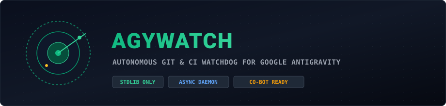

<div align="center">



<p align="center">
  <strong>Autonomous Git, Pull Request &amp; CI Watchdog Daemon for Google Antigravity CLI (agy)</strong>
</p>

<p align="center">
  <a href="https://www.python.org/"></a>
  <a href="#key-features"></a>
  <a href="#system-architecture"></a>
  <a href="#key-features"></a>
  <a href="#unified-bot-integration-with-agytele"></a>
  <a href="#quick-start"></a>
</p>

<p align="center">
  <a href="#overview">Overview</a> &bull;
  <a href="#key-features">Key Features</a> &bull;
  <a href="#system-architecture">Architecture</a> &bull;
  <a href="#unified-bot-integration-with-agytele">Unified Bot Integration</a> &bull;
  <a href="#command-reference">Commands</a> &bull;
  <a href="#quick-start">Quick Start</a> &bull;
  <a href="#project-structure">Project Structure</a> &bull;
  <a href="#verification-and-testing">Testing</a>
</p>

</div>

---

## Overview

**AgyWatch** là hệ thống daemon giám sát tự động (Watchdog) viết hoàn toàn bằng Python chuẩn (`asyncio`), đóng vai trò như một kỹ sư AI túc trực 24/7 cho các kho mã nguồn của bạn.

Hệ thống theo dõi liên tục trạng thái repository (local & remote qua GitHub CLI):
1. **Tự động phát hiện Pull Request mới**: Quét diff, kích hoạt **Google Antigravity CLI (`agy`)** phân tích thuật toán, cấu trúc vector hóa, độ phủ test và trả về báo cáo review kèm khuyến nghị `APPROVE` / `REQUEST_CHANGES`.
2. **Bác sĩ tự động (CI / Test Doctor)**: Khi phát hiện `pytest` hoặc GitHub Actions CI bị fail, trích xuất traceback lỗi đưa cho Antigravity chẩn đoán root-cause và đề xuất bản vá code tức thì.
3. **Thông báo & Tương tác 2 chiều qua Telegram**: Bắn thông báo ngay lên smartphone với các nút bấm trực quan: `[🔍 Review PR]`, `[🚀 Approve lên GitHub]`, `[🩺 Chẩn đoán lỗi]`.

---

## Key Features

<table>
  <thead>
    <tr>
      <th width="50%">Tính năng</th>
      <th width="50%">Cơ chế Kỹ thuật</th>
    </tr>
  </thead>
  <tbody>
    <tr>
      <td>
        <strong>Zero External Dependencies</strong><br />
        Chạy tức thì trên mọi môi trường chuẩn.
      </td>
      <td>
        Xây dựng 100% bằng thư viện tiêu chuẩn của Python 3.10+: <code>asyncio</code>, <code>urllib.request</code>, <code>json</code>, <code>socket</code>, <code>dataclasses</code>, <code>pathlib</code>. Không cần <code>pip install</code>.
      </td>
    </tr>
    <tr>
      <td>
        <strong>Tự Động Đánh Giá PR Chuyên Sâu</strong><br />
        Review cấu trúc toán học & hiệu năng.
      </td>
      <td>
        Trích xuất git diff từ <code>gh pr diff</code>, kích hoạt <code>agy --output-format stream-json</code> với prompt thẩm định chuyên biệt, tự động phát hiện vi phạm vector hóa hoặc lỗi biên tính toán.
      </td>
    </tr>
    <tr>
      <td>
        <strong>Chẩn Đoán Lỗi Tự Động (Self-Healing Doctor)</strong><br />
        Khám sức khỏe kiểm thử và CI runs.
      </td>
      <td>
        Giám sát <code>gh run list</code> và test suite cục bộ. Tự động gom failed traceback, triệu hồi Agent phân tích nguyên nhân gốc rễ và tạo snippet sửa lỗi.
      </td>
    </tr>
    <tr>
      <td>
        <strong>Thiết Kế Khả Tích Hợp (Co-Bot Ready)</strong><br />
        Dùng chung 1 bot với <code>AgyTele</code>.
      </td>
      <td>
        Cung cấp hàm <code>attach_to_agy_tele()</code>. Cho phép nhúng trực tiếp toàn bộ daemon và menu lệnh vào bot <b>AgyTele</b> đang chạy mà không gây xung đột polling (HTTP 409 Conflict).
      </td>
    </tr>
    <tr>
      <td>
        <strong>Khóa Socket Đơn Tiến Trình (Port 9879)</strong><br />
        Ngăn chặn chạy trùng lặp ở chế độ Standalone.
      </td>
      <td>
        Bắt buộc ràng buộc socket trên <code>127.0.0.1:9879</code>. Đảm bảo an toàn tài nguyên khi chạy nền.
      </td>
    </tr>
  </tbody>
</table>

---

## System Architecture

```text
               ┌──────────────────────────────────────────────┐
               │    Local Git Repos / GitHub Remote (gh)      │
               └──────────────────────┬───────────────────────┘
                                      │
                         (Polls PRs, CI, Test Suite)
                                      ▼
               ┌──────────────────────────────────────────────┐
               │              AgyWatch Service                │
               │   - GitInspector & Event Deduplication       │
               │   - Port 9879 Socket Lock (Standalone)       │
               └──────────────┬────────────────┬──────────────┘
                              │                │
            (Headless stream-json)    (Interactive Dispatch)
                              ▼                ▼
       ┌────────────────────────────┐    ┌───────────────────────────────────┐
       │   Antigravity CLI (agy)    │    │      Unified Telegram Router      │
       │   - PR Code Reviewer       │    │   - Real-time Alert Messages      │
       │   - Self-Healing Doctor    │    │   - Inline Action Buttons         │
       └────────────────────────────┘    │   - [Review] [Approve] [Doctor]   │
                                         └───────────────────────────────────┘
```

---

## Unified Bot Integration with AgyTele

Nếu bạn đã có **AgyTele** (`Anti-Tele-An`) đang chạy, bạn **không cần mở 2 bot riêng biệt**. Bạn có thể kết hợp cả 2 dùng chung 1 Bot Telegram duy nhất chỉ với **3 dòng code**:

### Hướng dẫn tích hợp vào `Anti-Tele-An/main.py`:

Mở file `C:\Users\ADMIN\Documents\Anti-Tele-An\main.py`, thêm import và dòng gắn kết nối ngay sau khi tạo `router`:

```python
# Thêm import ở đầu file:
import sys
sys.path.append("C:/Users/ADMIN/Documents/AgyWatch")
from src.integration import attach_to_agy_tele

# Trong hàm run_bot(), ngay sau dòng:
router = BotRouter(tg, state, bridge)

# THÊM DÒNG NÀY:
attach_to_agy_tele(tele_router=router, tele_tg=tg)
```

**Kết quả:**
- Bot Telegram hiện tại của bạn sẽ có đầy đủ các tính năng lập trình của AgyTele **VÀ** các tính năng giám sát PR/CI của AgyWatch.
- Không lo bị lỗi `409 Conflict: terminated by other getUpdates request`.

---

## Command Reference

| Lệnh | Cú pháp | Chức năng | Giao diện |
| :--- | :--- | :--- | :--- |
| `/watch` | `/watch [status\|check]` | Kiểm tra trạng thái daemon, danh sách repo theo dõi, hoặc ép quét ngay lập tức (`/watch check`) | Text |
| `/prs` | `/prs [repo_name]` | Liệt kê các Pull Request đang mở kèm nút bấm Review nhanh | Inline Buttons |
| `/review` | `/review <PR_NUM> [repo]` | Yêu cầu Antigravity CLI phân tích sâu mã nguồn và gửi báo cáo chi tiết | Inline Buttons |
| `/doctor` | `/doctor [local_path]` | Chạy kiểm thử cục bộ (`pytest`) hoặc khám lỗi CI Actions gần nhất | Text |

---

## Quick Start (Standalone Mode)

Nếu muốn chạy AgyWatch như một ứng dụng độc lập riêng biệt:

### 1. Khởi chạy bằng một cú nhấp chuột (Windows):
Nhấp đúp chuột vào file `run.bat`.

### 2. Khởi chạy bằng dòng lệnh:
```bash
# Thiết lập cấu hình nhanh qua wizard tương tác
python setup.py

# Khởi chạy daemon
python main.py
```

### 3. File cấu hình mẫu (`config.json`):
```json
{
  "bot_token": "YOUR_TELEGRAM_BOT_TOKEN",
  "allowed_user_ids": [6876958198],
  "poll_interval_seconds": 60,
  "default_model": "gemini-4-argon-high",
  "auto_review_new_prs": false,
  "auto_notify_telegram": true,
  "repos": [
    {
      "name": "huuan26/polars-anta",
      "local_path": "C:/Users/ADMIN/Documents/polars-anta",
      "watch_prs": true,
      "watch_ci": true,
      "watch_local_tests": true,
      "test_command": "python -m pytest"
    }
  ]
}
```

---

## Project Structure

```text
AgyWatch/
├── assets/
│   └── agy_watch_banner.svg   # Scalable pixel art radar banner
├── data/
│   └── state.json             # Bộ lưu trữ trạng thái PRs & CI đã duyệt
├── src/
│   ├── __init__.py            # Khai báo package và export interfaces
│   ├── agy_runner.py          # Subprocess runner stream-json của Antigravity CLI
│   ├── config.py              # Schema & nạp cấu hình (hỗ trợ kế thừa AgyTele)
│   ├── doctor.py              # Bác sĩ tự động phân tích root-cause test & CI
│   ├── git_inspector.py       # Async wrapper cho Git & GitHub CLI (gh)
│   ├── integration.py         # Cầu nối tích hợp AgyWatch vào AgyTele dùng chung 1 bot
│   ├── reviewer.py            # Engine tạo prompt review PR và phân loại kết quả
│   ├── telegram_api.py        # HTTP Client Telegram thuần Python (Zero-deps)
│   ├── watch_router.py        # Bộ định tuyến lệnh Telegram cho AgyWatch
│   └── watch_service.py       # Vòng lặp daemon bất đồng bộ trung tâm
├── tests/
│   └── test_core.py           # Unit tests kiểm tra logic cốt lõi
├── config.example.json        # Cấu hình tham chiếu mẫu
├── config.json                # Cấu hình đang sử dụng
├── main.py                    # Điểm khởi động Standalone & Socket lock 9879
├── run.bat                    # Launcher 1-click Windows
├── setup.py                   # Wizard cài đặt tương tác
└── README.md                  # Hướng dẫn chi tiết dự án
```

---

## Verification and Testing

Chạy toàn bộ unit test tích hợp sẵn bằng test runner nguyên bản của Python:

```bash
python -m unittest discover -s tests -v
```

---

<div align="center">

**AgyWatch &bull; Autonomous Git &amp; CI Watchdog for Google Antigravity**  
Maintained with ❤️ by [huuan26](https://github.com/huuan26)

</div>
